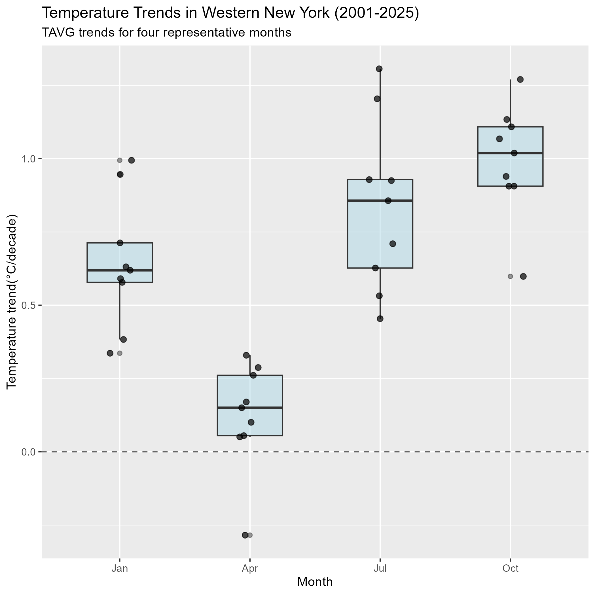
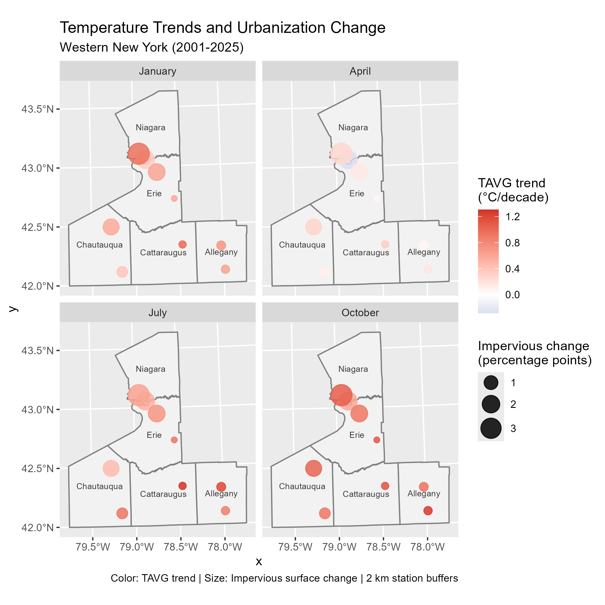
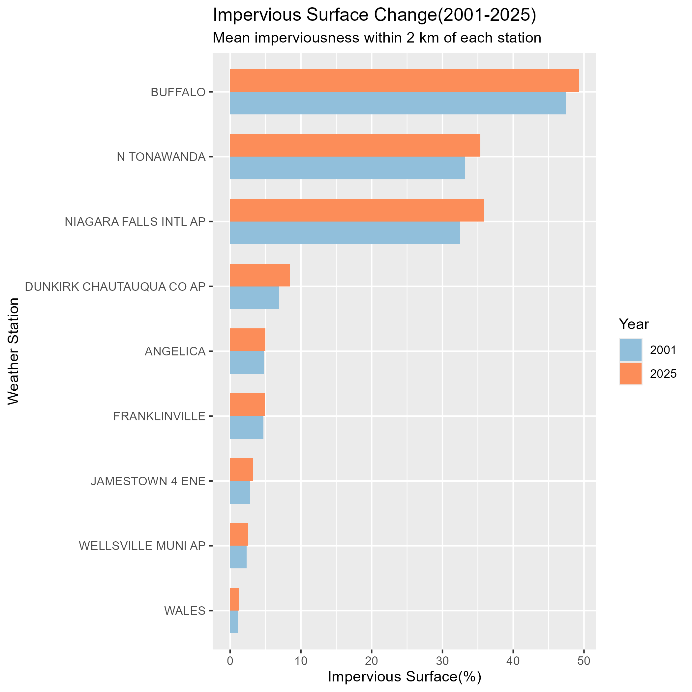
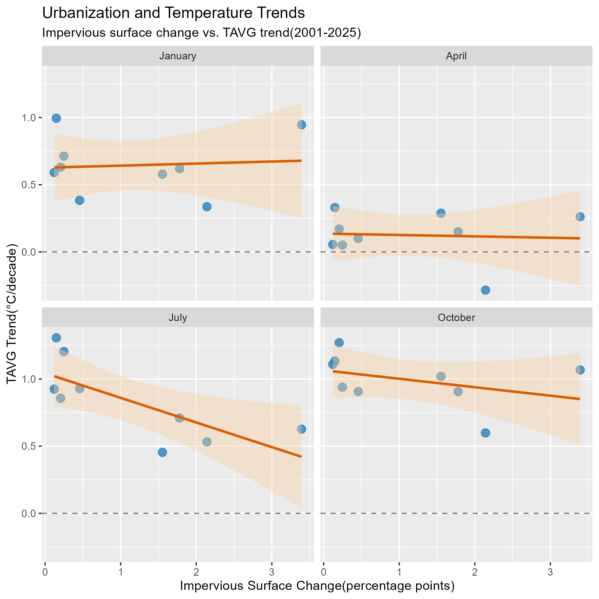
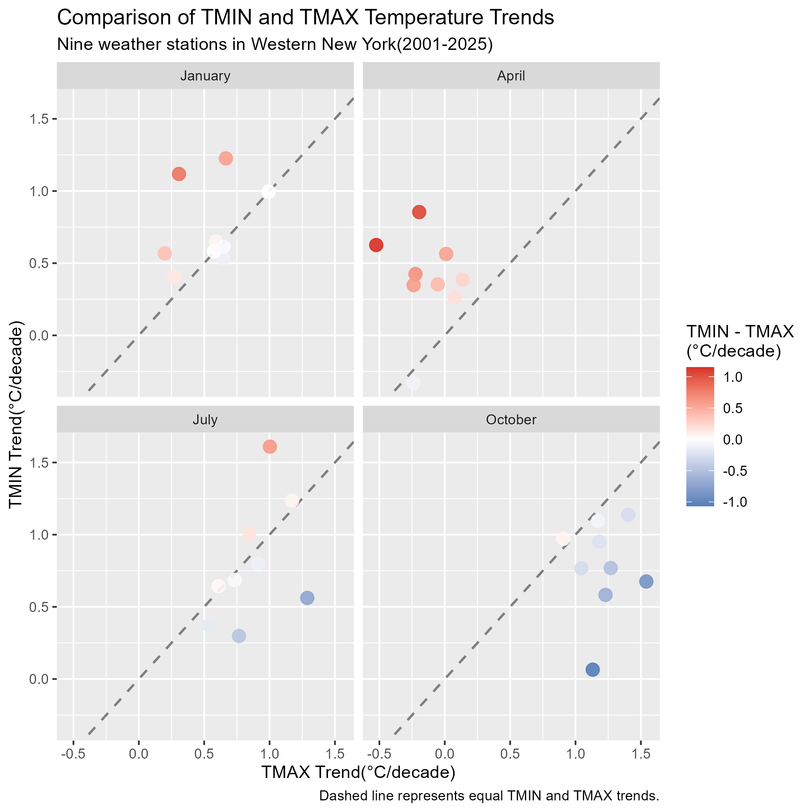

# Introduction
Rising temperatures are a major concern under global climate change, but warming can also be influenced by local
factors. Urbanization is one such factor, as the expansion of impervious surfaces such as roads, buildings, and parking lots may affect local temperatures. These surfaces can absorb and store heat, which may make urban areas warmer than surrounding rural areas.

Western New York is an interesting area for studying these changes because it includes both urban and rural areas. The study area includes five counties in Western New York: Erie, Niagara, Chautauqua, Cattaraugus, and Allegany. These counties have different levels of development, providing an opportunity to examine the relationship between warming and urbanization. Temperature changes may also vary across different months, and minimum and maximum temperatures may not increase at the same rate.

This project examines temperature trends in five counties in Western New York from 2001 to 2025. It focuses on three research questions:
1. How did temperature trends change across four representative months: January, April, July, and October?
2. Did weather stations with greater increases in impervious surfaces show stronger warming trends?
3. How did minimum temperature (TMIN) trends compare with maximum temperature (TMAX) trends across different months, and how did these differences vary with impervious surface changes?
# Materials and methods
This project uses three main datasets: temperature, impervious surface, and county boundary data. Daily temperature records from 2001 to 2025 were downloaded from the NOAA Global Historical Climatology Network-Daily (GHCN-Daily). County boundaries were obtained from the U.S. Census Bureau to select weather stations within the five counties in Western New York. Impervious surface data for 2001 and 2025 were obtained from the National Land Cover Database (NLCD).

For the temperature data, I first cleaned the daily records and removed missing or invalid values. Daily maximum temperature (TMAX) and minimum temperature (TMIN) were used to calculate average temperature (TAVG). The daily data were then converted into monthly averages. I kept months with at least 80% valid daily observations and stations with at least 95% monthly completeness. January, April, July, and October were selected to represent winter, spring, summer, and fall. Linear regression was used to calculate temperature trends for each station and month from 2001 to 2025.

For the NLCD data, I created a 2 km buffer around each weather station and calculated the mean impervious surface percentage for both years. The difference between 2025 and 2001 was used to measure urbanization change.

Finally, I combined the temperature trends and impervious surface changes using station IDs to examine their relationships.

```{r}
x=3+4
```

Refer to output in your narrative like this: x=`r x` .

Load any required packages in a code chunk (you may need to install some packages):

```{r, message=F, warning=F}
library(tidyverse)
library(leaflet)
library(kableExtra)
library(htmlwidgets)
library(widgetframe)
knitr::opts_chunk$set(widgetframe_widgets_dir = 'widgets' ) 
knitr::opts_chunk$set(cache=TRUE)  # cache the results for quick compiling
```

## Download and clean all required data

```{r}
n=20
data=data.frame(x=runif(n,-180,180),
                y=runif(n,-60,60),
                size = runif(n, 5, 20),
                category = factor(
                  sample(letters[1:5], n, replace = TRUE)
                  ),
                value = rnorm(n))
```

```{r, results='asis'}
data %>% 
  slice(1:10) %>% #show only 1:n rows
  kable(digits=2,align="c")%>% #make table and round to two digits
  kable_styling(bootstrap_options = 
                  c("striped", "hover", "condensed", "responsive")) #apply other formatting
```

Add any additional processing steps here.

# Results

Figure 1 shows the average temperature (TAVG) trends for four representative months from 2001 to 2025. Most weather stations showed warming trends, but the warming rates were different across months. October had the strongest warming, while April showed the weakest warming.


Figure 2 shows the spatial distribution of temperature trends and impervious surface changes across Western New York. The colors represent temperature trends, and the circle sizes represent impervious surface changes. The results show that temperature trends and urbanization changes varied between stations.


Figure 3 compares impervious surface percentages in 2001 and 2025. Some stations had higher impervious surface percentages than others, and the changes were different across locations.


Figure 4 shows the relationship between impervious surface changes and TAVG trends. January and April showed almost no relationship. July showed a negative relationship (r = -0.735, p = 0.024), while October also showed a negative but weaker relationship. Overall, greater increases in impervious surfaces were not always associated with stronger warming.


Figure 5 compares TMIN and TMAX trends across four months. In January and April, TMIN increased faster than TMAX at most stations. July showed mixed results, while October showed the opposite pattern. The circle sizes also show impervious surface changes, but there is no clear pattern between these changes and the differences in TMIN and TMAX trends.

# Conclusions
This project examined temperature trends and urbanization changes in five counties in Western New York from 2001 to 2025. The results showed that most weather stations experienced warming during the four selected months. However, the warming rates were different across months and locations.

I expected that weather stations with greater increases in impervious surfaces might show stronger warming trends. However, the results did not show a consistent positive relationship. July even showed a significant negative relationship between impervious surface changes and average temperature trends. This suggests that the relationship between urbanization and temperature change may be more complicated than expected. Other factors, such as local land cover, elevation, and distance from the Great Lakes, may also affect temperature trends.

The comparison between TMIN and TMAX showed that minimum temperatures increased faster in January and April at most stations, while maximum temperatures increased faster in October. This suggests that daytime and nighttime temperature trends may be different across months.

One limitation of this study is the small number of weather stations. In future work, I would like to include more stations and consider other environmental factors. I also plan to use more land cover data from different years to better understand the relationship between urbanization and local temperature changes.

# References
1. National Oceanic and Atmospheric Administration (NOAA). (n.d.). Global Historical Climatology Network-Daily (GHCN-Daily). National Centers for Environmental Information. https://www.ncei.noaa.gov/pub/data/ghcn/daily/

2. Multi-Resolution Land Characteristics Consortium (MRLC). (2026). Annual National Land Cover Database (NLCD): Fractional Impervious Surface. https://www.mrlc.gov/

3. U.S. Census Bureau. (2024). 2024 TIGER/Line Shapefiles: County and Equivalent Entities. https://www.census.gov/geographies/mapping-files/time-series/geo/tiger-line-file.2024.html
